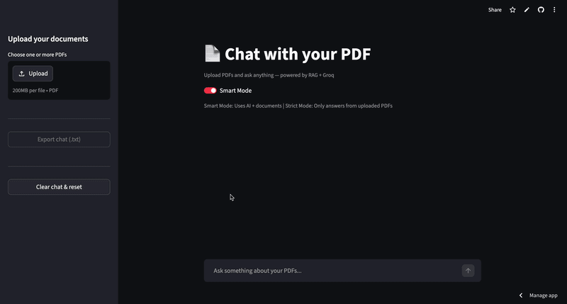

# ⚡ Hybrid RAG Document Intelligence

A conversational document-intelligence app built with **Retrieval-Augmented Generation**: upload PDFs, DOCX, TXT, or MD files and ask questions about them. Retrieval combines **dense vector search (ChromaDB MMR)** and **sparse keyword search (BM25)** fused with **Reciprocal Rank Rank Fusion**, then reranked by a **BGE cross-encoder** — with streaming answers from **Groq** models.

<p align="center">
  
</p>

---

## ✨ Features

- **2-Stage Hybrid Retrieval** — ChromaDB MMR + BM25 sparse search, fused with Reciprocal Rank Fusion (RRF), then reranked by `BAAI/bge-reranker-base`.
- **Streaming answers with citations** — token-by-token output and a source expander showing file + page (or "Whole document" for non-PDFs).
- **Document-scoped queries** — scope any question to a single document; the scope is enforced on *every* retrieval path (dense and sparse).
- **Self-healing model failover** — if a Groq model is unavailable before the first token, the next model in the chain is tried automatically.
- **Smart & Strict answer modes** — Smart may add flagged general knowledge; Strict answers only from retrieved context.
- **Compare & Generate studios** — side-by-side document comparison, plus Study Notes / Executive Summary / Technical Report / FAQ / Flashcard generation.
- **Document management** — search, format filter, per-document "Ask Questions" and "Delete" actions, upload-failure retry.
- **Session-isolated vector store** — one ChromaDB collection per session, with a storage console that lists and purges collections.
- **Live insights** — chunk counts, total size, and a real "last indexed" timestamp (relative time, recomputed each render).

---

## 🏗️ Architecture

```
User Query
    │
    ▼
History-Aware Query Rewriter (LLM)
    │
    ├──► Dense Vector Search (ChromaDB MMR, scope-filtered) ─┐
    │                                                       ├──► Reciprocal Rank Fusion ──► BGE Cross-Encoder ──► Top K Chunks
    └──► Sparse Keyword Search (BM25, scope-filtered) ───────┘                                                     │
                                                                                                                   ▼
                                                                                                       LLM Generation (Groq) + Streaming
```

Document text is treated as **untrusted data**: the system prompt fences retrieved context off from instructions, and user content is HTML-escaped before rendering.

---

## 🚀 Quickstart

### 1. Environment setup

```bash
# with uv (recommended)
uv venv --python 3.11 .venv
source .venv/bin/activate          # Windows: .venv\Scripts\activate
uv pip install -r requirements.txt

# or with plain pip
python3.11 -m venv .venv
source .venv/bin/activate          # Windows: .venv\Scripts\activate
pip install -r requirements.txt
```

Dependencies are **pinned** to the verified working set — see [requirements.txt](requirements.txt).

### 2. Configure environment (`.env`)

```env
GROQ_API_KEY=gsk_your_groq_api_key_here
GROQ_MODEL=qwen/qwen3.8-27b
```

### 3. Run the application

```bash
streamlit run app.py
```

Open **`http://localhost:8501`** in your browser.

### 4. Run the tests

```bash
python -m unittest discover -s tests -v
```

---

## 📁 Project Structure

```
app.py                      # Streamlit UI: sidebar, workspace, views, wiring
services/
  rag_service.py            # Hybrid retrieval, RRF, reranker, streaming + failover
  document_service.py       # Parsing, chunking, indexing, vector-store maintenance
  workflow_service.py       # Summary / comparison / artifact generation
  conversation_service.py   # Conversation + title helpers
assets/                     # Logo & decorative images (served as base64)
tests/                      # Unit tests for the pure logic
```

---

## 🔒 Security Notes

- XSRF protection and CORS checks are **enabled** (`.streamlit/config.toml`).
- Upload size is capped at **200 MB** per file; only `pdf/docx/txt/md` are accepted.
- Retrieved document text is fenced as untrusted data in the system prompt; HTML in user messages and filenames is escaped before rendering.
- The app has **no authentication** — run it locally or behind your own authenticated proxy. Do not expose it directly to the internet.

## License

MIT — see [LICENSE](LICENSE).
