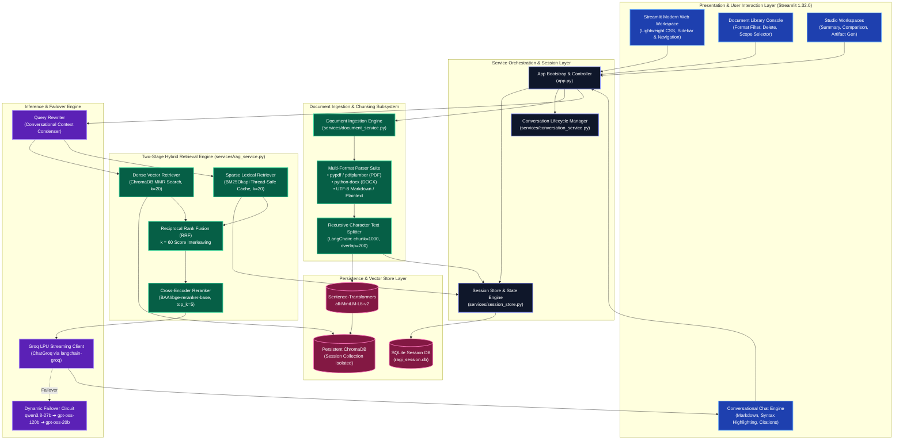
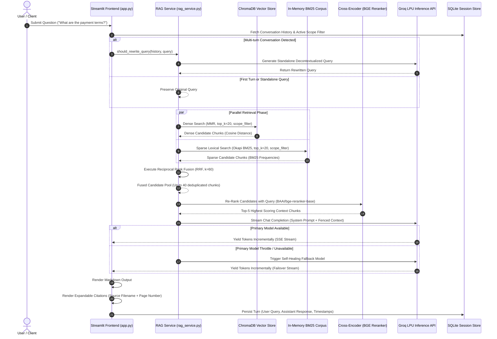

# RAGI — Enterprise Hybrid RAG Document Intelligence Platform

> High-performance, production-ready Retrieval-Augmented Generation (RAG) platform combining **dense vector retrieval (ChromaDB MMR)** and **sparse lexical search (BM25)** fused via **Reciprocal Rank Fusion (RRF)**, re-ranked by a **BGE cross-encoder**, and streamed via **Groq LPU hardware** with self-healing model failovers and session-isolated SQLite persistence.

[](https://www.python.org/)
[](https://streamlit.io/)
[](https://www.langchain.com/)
[](https://www.trychroma.com/)
[](https://groq.com/)
[](LICENSE)
[](tests)


---

## Table of Contents

1. [Platform Overview](#platform-overview)
2. [System Architecture](#system-architecture)
3. [End-to-End Query Lifecycle (UML Sequence Diagram)](#end-to-end-query-lifecycle-uml-sequence-diagram)
4. [Hybrid Retrieval & Re-Ranking Mechanics](#hybrid-retrieval--re-ranking-mechanics)
   - [Dense Semantic Retrieval (ChromaDB + MMR)](#1-dense-semantic-retrieval-chromadb--mmr)
   - [Sparse Lexical Retrieval (BM25Okapi)](#2-sparse-lexical-retrieval-bm25okapi)
   - [Reciprocal Rank Fusion (RRF)](#3-reciprocal-rank-fusion-rrf)
   - [Cross-Encoder Re-Ranking (`BAAI/bge-reranker-base`)](#4-cross-encoder-re-ranking-baaibge-reranker-base)
   - [Document-Scoped Multi-Route Enforcing](#5-document-scoped-multi-route-enforcing)
5. [Core Features & Capabilities](#core-features--capabilities)
6. [Workflow Studios & Artifact Generation](#workflow-studios--artifact-generation)
7. [Technology Stack](#technology-stack)
8. [Directory & Repository Layout](#directory--repository-layout)
9. [Installation & Setup](#installation--setup)
10. [Configuration & Environment Variables](#configuration--environment-variables)
11. [Testing & Quality Assurance](#testing--quality-assurance)
12. [Security & Isolation Architecture](#security--isolation-architecture)
13. [Maintainer Information](#maintainer-information)
14. [License](#license)

---

## Platform Overview

Traditional RAG implementations rely purely on dense embeddings or basic keyword lookups. In real-world enterprise environments, pure semantic search misses exact keyword identifiers (part numbers, technical acronyms, invoice codes), while pure keyword search fails on conceptual questions and semantic paraphrasing.

**RAGI** bridges this gap by implementing an enterprise-grade, two-stage **Hybrid Retrieval** pipeline:
- **Lexical precision** via BM25 Okapi to catch exact terms and code strings.
- **Conceptual depth** via ChromaDB Maximal Marginal Relevance (MMR) dense search with `sentence-transformers/all-MiniLM-L6-v2`.
- **Rank aggregation** via Reciprocal Rank Fusion ($k=60$) to interleave results fairly without arbitrary score scale calibrations.
- **Deep semantic re-ranking** using a cross-encoder model (`BAAI/bge-reranker-base`) evaluating query-document token interactions simultaneously.
- **Ultra-fast generation** powered by Groq's low-latency LPU inference with real-time token streaming and automated fallback chains.
- **Zero-loss persistence** utilizing lightweight SQLite caching (`ragi_session.db`) to withstand browser refreshes (F5) without losing documents, embeddings, or chat history.

---

## System Architecture

The following UML component architecture diagram illustrates the end-to-end modular structure of RAGI:



---

## End-to-End Query Lifecycle (UML Sequence Diagram)

The following UML sequence diagram details the end-to-end execution of a user query—highlighting query contextualization, parallel hybrid search, cross-encoder score ranking, streaming token response, and citation rendering:



---

## Hybrid Retrieval & Re-Ranking Mechanics

### 1. Dense Semantic Retrieval (ChromaDB + MMR)
Dense embeddings capture abstract semantic relationships and conceptual synonyms. RAGI utilizes `sentence-transformers/all-MiniLM-L6-v2` generating 384-dimensional dense vectors stored within ChromaDB collections.
- Rather than naive Top-$K$ cosine similarity (which yields redundant chunks from identical sections), RAGI uses **Maximal Marginal Relevance (MMR)**.
- MMR balances query relevance with novelty against already selected chunks, ensuring broad coverage of document facets:

$$\text{MMR} = \arg\max_{d_i \in R \setminus S} \left[ \lambda \cdot \text{Sim}(d_i, q) - (1 - \lambda) \cdot \max_{d_j \in S} \text{Sim}(d_i, d_j) \right]$$

### 2. Sparse Lexical Retrieval (BM25Okapi)
Dense embeddings struggle on high-specificity domain tokens: hex codes, product IDs, legal clauses, variable names, and numerical parameters. RAGI incorporates `rank-bm25` (BM25Okapi) with a custom, thread-safe, multi-corpus cache:
- Tokenization strips non-alphanumeric noise and normalizes case.
- Exact term frequency ($TF$) and inverse document frequency ($IDF$) guarantee that rare technical terms receive highest priority.

### 3. Reciprocal Rank Fusion (RRF)
Raw scores from dense vector search (cosine distance $\in [0, 2]$) and BM25 ($\in [0, \infty)$) cannot be simply summed because their scales and distributions are incompatible. RAGI employs **Reciprocal Rank Fusion**:

$$RRF(d) = \sum_{m \in M} \frac{1}{k + r_m(d)}$$

Where:
- $M = \{\text{Dense Retriever}, \text{Sparse BM25}\}$
- $r_m(d)$ is the 1-based rank position of document chunk $d$ in retriever $m$.
- $k = 60$ is the smoothing constant mitigating the penalty for lower-ranked candidates.
- If a document appears in both dense and sparse top lists, its reciprocal scores compound, boosting it to the top of the re-ranking queue.

### 4. Cross-Encoder Re-Ranking (`BAAI/bge-reranker-base`)
Bi-encoders (embedding models) compare document and query vectors independently. A **Cross-Encoder** (`BAAI/bge-reranker-base`) accepts the combined pair `[CLS] Query [SEP] Chunk [SEP]` into full self-attention layers simultaneously:
- Evaluates full token-to-token contextual cross-attention.
- Strips false positives surfaced during initial broad candidate retrieval.
- Returns the top-5 definitive context chunks passed to the LLM context window.

### 5. Document-Scoped Multi-Route Enforcing
When a user selects a specific document in the workspace:
- **Dense Vector Search** applies an explicit metadata filter: `where={"source": doc_name}`.
- **Sparse BM25 Search** extracts only chunk indices corresponding to `metadata["source"] == doc_name`.
- Scoping is **strictly enforced** across both paths, eliminating cross-document hallucinations or context leakage.

---

## Core Features & Capabilities

| Feature | Technical Implementation | Benefit |
| :--- | :--- | :--- |
| **2-Stage Hybrid Retrieval** | ChromaDB MMR + BM25 Okapi + RRF ($k=60$) + BGE Reranker | Combines conceptual comprehension with surgical keyword precision. |
| **Real-Time Token Streaming** | Generator streaming via Groq LPU API | Sub-second Time to First Token (TTFT) and smooth typewriter rendering. |
| **Expandable Citations** | Metadata tracking (`source`, `page`) mapped to rendered expanders | Complete auditability back to exact pages or "Whole document". |
| **Self-Healing Failover Chain** | Ordered fallback (`qwen3.8-27b` ➔ `gpt-oss-120b` ➔ `gpt-oss-20b`) | Zero downtime during Groq rate-limiting or individual model deprecation. |
| **Strict vs. Smart Modes** | System prompt governance switch | **Strict:** Confined purely to context. **Smart:** Integrates general knowledge with disclaimer. |
| **History-Aware Query Rewriter** | Few-shot conditional query de-contextualizer | Resolves pronouns ("it", "they", "its cost") using conversation history. |
| **Session-Isolated Vector Collections** | UUID-based Chroma collections (`ragi_<uuid>`) | Prevents data cross-talk between workspaces; one-click collection purge. |
| **SQLite Session Persistence** | `ragi_session.db` storing docs, chunks, and messages | Survives browser page refreshes (F5) without losing active state. |
| **Multi-Format Ingestion** | `pypdf`, `pdfplumber`, `python-docx`, UTF-8 Plaintext & Markdown | Uniform indexing across diverse corporate file formats up to 200 MB. |
| **Storage Console & Purge** | Vector Store Management dashboard | Lists active collections, disk consumption, chunk counts, and one-click database reset. |

---

## Workflow Studios & Artifact Generation

Beyond conversational Q&A, RAGI includes dedicated specialized studios:

1. **Executive Summarizer:**
   - Employs **representative chunk sampling** (head, evenly spaced body progression, and conclusion) to eliminate 90%+ drop-off common in naive sampling.
   - Generates structured executive summaries with core takeaways, methodologies, and findings.

2. **Comparative Analysis Studio:**
   - Side-by-side comparative evaluation of any two uploaded documents.
   - Contrasts scope, structural differences, agreements, and conflicting points in a clean markdown table.

3. **Specialized Artifact Generator:**
   - **Comprehensive Study Notes:** Topic-by-topic hierarchical breakdowns.
   - **Executive Briefing:** Concise bulleted briefing for leadership reviews.
   - **Technical Deep Dive:** Architecture, parameters, specifications, and code snippets.
   - **Comprehensive FAQ:** Automatically extracts top questions and answers from the corpus.
   - **Interactive Flashcards:** Question/Answer review cards for accelerated learning.

---

## Technology Stack

| Layer | Component | Version | Description |
| :--- | :--- | :--- | :--- |
| **UI Framework** | [Streamlit](https://streamlit.io/) | `1.32.0` | Reactive Python web interface with custom CSS styling and responsive layout. |
| **RAG Orchestration** | [LangChain](https://www.langchain.com/) | `0.1.17` | Chunking splitters, vector store abstractions, and message schema management. |
| **Inference Hardware** | [Groq](https://groq.com/) | `langchain-groq 0.1.5` | Ultra-fast LPU inference executing Qwen and OSS models. |
| **Vector Database** | [ChromaDB](https://www.trychroma.com/) | `0.4.24` | Local embedded vector database with persistent on-disk index. |
| **Sparse Lexical Search** | [Rank-BM25](https://github.com/dorianbrown/rank_bm25) | `0.2.2` | Pure Python implementation of BM25Okapi scoring algorithm. |
| **Embedding Model** | [Sentence-Transformers](https://www.sbert.net/) | `2.7.0` | `all-MiniLM-L6-v2` (384-dimensional dense vectors). |
| **Re-Ranking Model** | [BAAI/bge-reranker-base](https://huggingface.co/BAAI/bge-reranker-base) | CrossEncoder | Deep cross-attention score evaluation for candidate refinement. |
| **Deep Learning Engine** | [PyTorch](https://pytorch.org/) | `2.2.2` | CPU-optimized tensor compute backend for Hugging Face transformer models. |
| **Document Parsers** | `pypdf`, `pdfplumber`, `python-docx` | Latest | Robust PDF page-by-page text extraction and Word DOCX parsing. |
| **Session Persistence** | [SQLite3](https://docs.python.org/3/library/sqlite3.html) | Built-in | Zero-dependency local relational persistence for conversations and chunks. |

---

## Directory & Repository Layout

```text
rag-chatbot/
├── .env                           # Local environment configuration (GROQ_API_KEY, GROQ_MODEL)
├── .env.example                   # Environment configuration template
├── .gitignore                     # Git exclusion rules (venv, ChromaDB, logs, databases)
├── .session_id                    # Persistent session UUID anchor file
├── .streamlit/
│   └── config.toml                # Streamlit server config (XSRF, CORS, port, theme)
├── assets/
│   ├── mountain-bottom-left.png   # Custom UI background decoration
│   ├── mountain-top-right.png     # Custom UI header backdrop
│   └── ragi-logo.png              # Vector brand logo asset
├── chroma_db/                     # ChromaDB persistent vector index directory (git-ignored)
├── ragi_session.db                # SQLite session store (documents, chunks, chat history)
├── requirements.txt               # Production dependencies pinned to tested working set
├── runtime.txt                    # Target deployment Python runtime (python-3.11)
├── demo.gif                       # Animated product demonstration walkthrough
├── app.py                         # Master Streamlit UI, view routing, and event handling
├── services/
│   ├── __init__.py
│   ├── icons.py                   # High-res SVG inline icon component library
│   ├── document_service.py        # File ingestion, chunking, parsing, and collection management
│   ├── rag_service.py             # Hybrid search (MMR + BM25), RRF, Cross-Encoder, and Groq streaming
│   ├── session_store.py           # SQLite persistence layer for conversations and session continuity
│   ├── conversation_service.py    # Conversation state creation and heuristic title generation
│   └── workflow_service.py        # Executive summaries, document comparisons, and artifact studios
└── tests/
    ├── __init__.py
    └── test_helpers.py            # Comprehensive 52-test unit and regression test suite
```

---

## Installation & Setup

### Prerequisites

- **Python 3.11** (Recommended and verified version).
- A valid **[Groq Cloud API Key](https://console.groq.com/keys)**.

---

### Step 1: Clone the Repository

```bash
git clone https://github.com/AviralNITW/rag-chatbot.git
cd rag-chatbot
```

---

### Step 2: Set Up Virtual Environment

#### Option A: Using `uv` (Fastest, Recommended)
```bash
uv venv --python 3.11 .venv

# Windows (Command Prompt / PowerShell)
.venv\Scripts\activate

# Linux / macOS
source .venv/bin/activate

uv pip install -r requirements.txt
```

#### Option B: Using Standard `python`
```bash
# Windows
python -m venv .venv
.venv\Scripts\activate

# Linux / macOS
python3.11 -m venv .venv
source .venv/bin/activate

pip install -r requirements.txt
```

---

### Step 3: Configure Environment Variables

Create a `.env` file in the project root:

```bash
# Windows (PowerShell)
Copy-Item .env.example .env

# Linux / macOS
cp .env.example .env
```

Populate `.env` with your Groq credentials:

```env
GROQ_API_KEY=gsk_your_groq_api_key_here
GROQ_MODEL=qwen/qwen3.8-27b
```

---

### Step 4: Run the Application

```bash
streamlit run app.py
```

Once started, open your web browser at: **`http://localhost:8501`**

---

## Configuration & Environment Variables

| Variable | Required | Default Value | Description |
| :--- | :---: | :--- | :--- |
| `GROQ_API_KEY` | **Yes** | *None* | Authentication token for Groq Cloud inference API. |
| `GROQ_MODEL` | No | `qwen/qwen3.8-27b` | Primary LLM model identifier used for generation. |
| `ANONYMIZED_TELEMETRY` | No | `False` | Disables telemetry pings in ChromaDB client. |

---

## Testing & Quality Assurance

RAGI ships with an extensive, hermetic unit testing suite covering retrieval logic, RRF fusion, BM25 scoping, query rewrites, session persistence, and regression safety. All tests execute **without network calls or external GPU dependencies**.

To run the complete test suite:

```bash
# Using active virtual environment
python -m unittest discover -s tests -v
```

### Verified Test Breakdown (52 Tests Passing):
- **Formatting & Helpers:** File size formatting, humanized relative timestamps (`test_format_file_size`, `test_relative_time`).
- **Format Filtering:** Extension categorization for PDF, DOCX, TXT, MD (`test_pdf_filter`, `test_markdown_label`).
- **Session Identity:** File-based UUID persistence, rotation on workspace reset (`test_session_id_persistence_and_rotation`).
- **SQLite Persistence:** Chunk serialization, document metadata lifecycle, numpy float32 conversion safety.
- **BM25 Scoping & Cache:** Independent corpus caching, thread-safe access, scope boundary protection.
- **Reciprocal Rank Fusion:** Multi-retriever score computation, rank boost verification, deduplication.
- **Cross-Encoder Model Chain:** Empty input safety, deduplicated model failover ordering.
- **Query Rewrite Heuristics:** Conversational pronoun detection, elliptical follow-up triggers, standalone query bypass.
- **Workflow Sampling:** Representative head/body/tail chunk sampling for large document summarization.
- **Application Regressions:** Balanced HTML tags, XSRF enforcement, citation defaults, template sanitization.

---

## Security & Isolation Architecture

1. **Context Fencing & Injection Defense:**
   - Uploaded documents are treated as untrusted user input. Retrieved chunks are fenced inside strict delimiters (`--- BEGIN RETRIEVED CONTEXT ---` / `--- END RETRIEVED CONTEXT ---`).
   - The system prompt explicitly orders the model to disregard instructions embedded within document texts.
2. **HTML Sanitization & XSS Mitigation:**
   - Document filenames, user prompts, and conversation metadata are escaped via `html.escape()` prior to UI rendering.
3. **Session & Vector Isolation:**
   - Each session resolves to a sanitized UUID collection name (`ragi_<sanitized_uuid>`).
   - Multiple users or multiple workspace resets operate in isolated collections without vector pollution.
4. **Server Hardening:**
   - File uploads capped at **200 MB** (`maxUploadSize = 200` in `.streamlit/config.toml`).
   - Explicit `enableXsrfProtection = true` and `enableCORS = true` headers configured.

---

## Maintainer Information

Engineered and maintained by **[AviralNITW](https://github.com/AviralNITW)**.

- **GitHub:** [@AviralNITW](https://github.com/AviralNITW)
- **Project Repository:** [rag-chatbot](https://github.com/AviralNITW/rag-chatbot)

---

## License

This project is licensed under the [MIT License](LICENSE).
